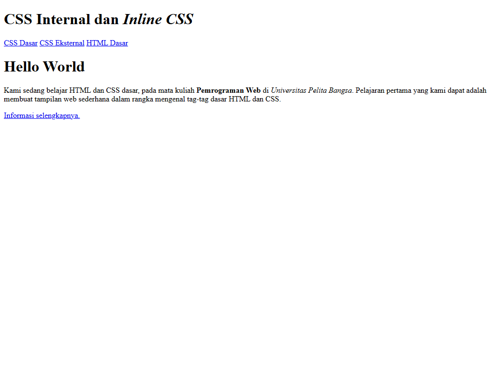
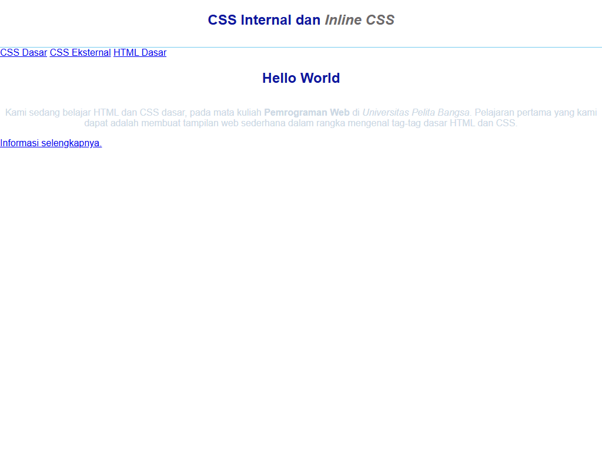
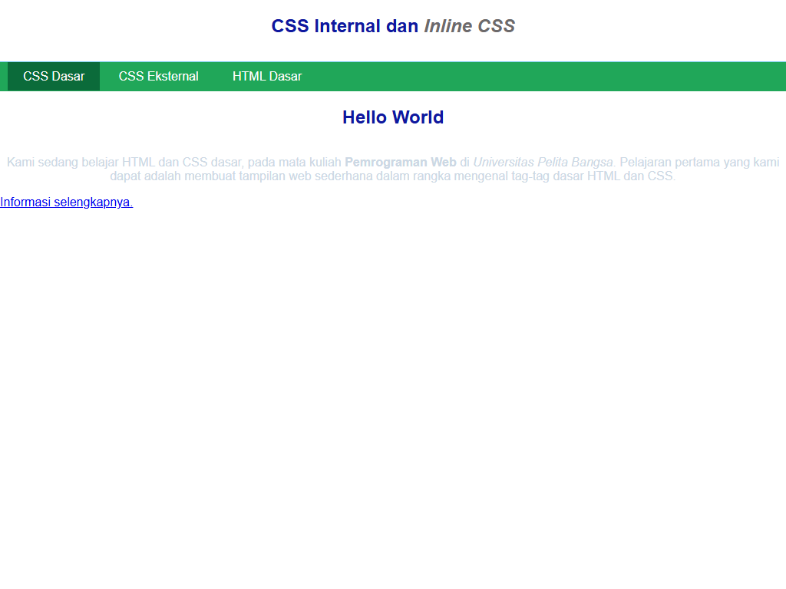
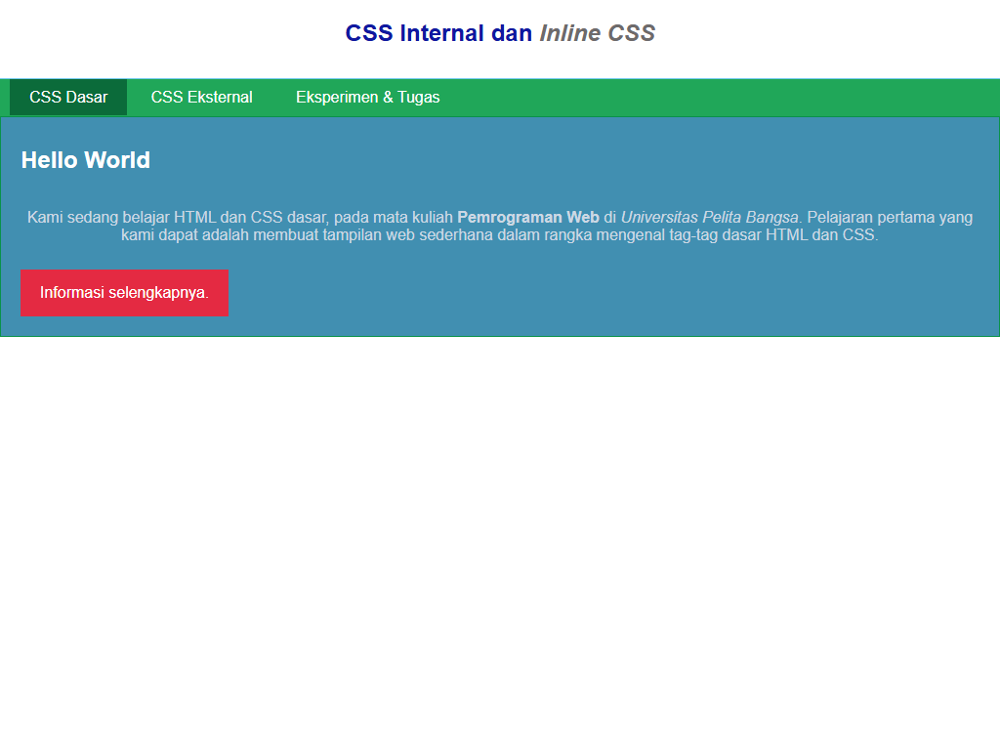
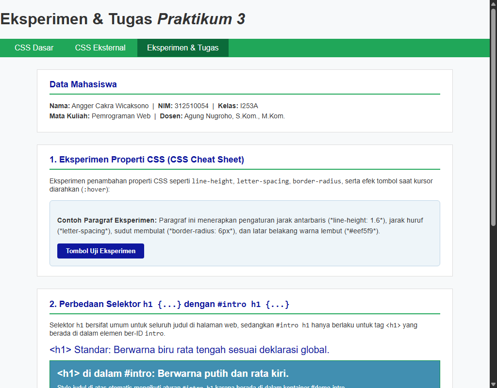

# Praktikum 3: CSS Dasar

Repository ini disusun untuk memenuhi tugas **Praktikum 3 - CSS Dasar** pada mata kuliah Pemrograman Web.

**Identitas Mahasiswa:**
- **Nama:** Angger Cakra Wicaksono
- **NIM:** 312510054
- **Kelas:** I253A
- **Program Studi:** Teknik Informatika
- **Dosen Pengampu:** Agung Nugroho, S.Kom., M.Kom.
- **Kampus:** Universitas Pelita Bangsa

---

## Panduan Screenshot Tugas

Semua file tangkapan layar (*screenshot*) tersimpan rapi di dalam direktori `screenshots/` dengan format penamaan angka (`1.png` sampai `6.png`) sesuai urutan pengerjaan pada modul:

| No File | Aplikasi / Lokasi | Yang Harus Di-Screenshot / Ditampilkan |
|:---|:---|:---|
| **`1.png`** | Browser | **Langkah 1 (Gambar 2 Modul):** Tampilan awal dokumen HTML murni tanpa gaya CSS. Seluruh elemen tampil polos (*default browser style*). |
| **`2.png`** | Browser | **Langkah 2 (Gambar 3 Modul):** Penambahan Internal CSS pada tag `<head>` (font *Open Sans*, border bawah pada `<header>`, dan perataan judul `<h1>` ke tengah berwarna biru). |
| **`3.png`** | Browser | **Langkah 3 (Gambar 4 Modul):** Penambahan Inline CSS pada tag `<p>` di dalam `#intro` (teks paragraf rata tengah dengan warna `#ccd8e4`). |
| **`4.png`** | Browser | **Langkah 4 (Gambar 5 Modul):** Pembuatan dan penyisipan file eksternal `style_eksternal.css` untuk mempercantik bilah navigasi `<nav>` berwarna hijau `#20A759` beserta efek tautannya. |
| **`5.png`** | Browser | **Langkah 5 (Gambar 6 Modul):** Penambahan ID Selector (`#intro`) dan Class Selector (`.button`, `.btn-primary`) pada `style_eksternal.css` sehingga membentuk kotak intro biru bergaris hijau dan tombol aksi merah. |
| **`6.png`** | Browser (`eksperimen.html`) | **Tugas & Evaluasi Modul:** Halaman interaktif implementasi eksperimen CSS modern serta pengujian nyata atas pertanyaan spesifitas dan prioritas CSS. |

---

## Struktur Direktori Proyek

```text
Lab3Web/
├── screenshots/
│   ├── 1.png               # Tampilan dokumen HTML dasar (Gambar 2)
│   ├── 2.png               # Penerapan Internal CSS (Gambar 3)
│   ├── 3.png               # Penerapan Inline CSS (Gambar 4)
│   ├── 4.png               # Penerapan External CSS navigasi (Gambar 5)
│   ├── 5.png               # Penerapan ID & Class Selector (Gambar 6)
│   └── 6.png               # Eksperimen CSS & pembuktian jawaban soal
├── index.html              # Landing page utama repositori (CSS Dasar terintegrasi)
├── lab2_css_dasar.html     # File latihan utama sesuai instruksi modul
├── lab2_css_eksternal.html # File demonstrasi implementasi CSS Eksternal
├── style_eksternal.css     # File stylesheet terpisah (Eksternal CSS)
├── eksperimen.html         # Halaman pengujian & pembuktian tugas modul
└── README.md               # Laporan dokumentasi lengkap praktikum
```

---

## Langkah-langkah Praktikum

### 1. Membuat Dokumen HTML Dasar (`lab2_css_dasar.html`)
Langkah awal adalah membuat struktur dokumen HTML5 standar yang memuat elemen `<header>`, menu `<nav>`, dan kontainer `<div id="intro">` dengan tombol tautan:

```html
<!DOCTYPE html>
<html lang="en">
<head>
    <meta charset="UTF-8">
    <meta name="viewport" content="width=device-width, initial-scale=1.0">
    <title>CSS Dasar</title>
</head>
<body>
    <header>
        <h1>CSS Internal dan <i>Inline CSS</i></h1>
    </header>
    <nav>
        <a href="lab2_css_dasar.html">CSS Dasar</a>
        <a href="lab2_css_eksternal.html">CSS Eksternal</a>
        <a href="lab1_tag_dasar.html">HTML Dasar</a>
    </nav>
    <!-- CSS ID Selector -->
    <div id="intro">
        <h1>Hello World</h1>
        <p>Kami sedang belajar HTML dan CSS dasar, pada mata kuliah 
        <b>Pemrograman Web</b> di <i>Universitas Pelita Bangsa</i>. Pelajaran pertama 
        yang kami dapat adalah membuat tampilan web sederhana dalam rangka mengenal 
        tag-tag dasar HTML dan CSS.</p>
        <!-- CSS Class Selector -->
        <a class="button btn-primary" href="#intro">Informasi selengkapnya.</a>
    </div>
</body>
</html>
```

**Screenshot Hasil Langkah 1 (HTML Murni):**  


---

### 2. Mendeklarasikan Internal CSS
Menambahkan aturan CSS di dalam tag `<style>` pada bagian `<head>` dokumen untuk mengatur tipografi body, border header, dan perataan judul:

```html
<style>
    body {
        font-family: 'Open Sans', sans-serif;
    }
    header {
        min-height: 80px;
        border-bottom: 1px solid #77CCEF;
    }
    h1 {
        font-size: 24px;
        color: #0F189F;
        text-align: center;
        padding: 20px 10px;
    }
    h1 i {
        color: #6d6a6b;
    }
</style>
```

**Screenshot Hasil Langkah 2 (Internal CSS):**  


---

### 3. Menambahkan Inline CSS
Menyisipkan atribut `style` langsung pada tag `<p>` di dalam elemen `<div id="intro">`:

```html
<p style="text-align: center; color: #ccd8e4;">
    Kami sedang belajar HTML dan CSS dasar, pada mata kuliah ...
</p>
```

**Screenshot Hasil Langkah 3 (Inline CSS):**  


---

### 4. Membuat dan Mengintegrasikan CSS Eksternal (`style_eksternal.css`)
Membuat file terpisah bernama `style_eksternal.css` untuk mendeklarasikan penataan bilah navigasi:

```css
nav {
    background: #20A759;
    color: #fff;
    padding: 10px;
}
nav a {
    color: #fff;
    text-decoration: none;
    padding: 10px 20px;
}
nav .active, 
nav a:hover {
    background: #0B6B3A;
}
```

Kemudian dihubungkan pada bagian `<head>` berkas HTML menggunakan tag `<link>`:
```html
<link rel="stylesheet" href="style_eksternal.css" type="text/css">
```

**Screenshot Hasil Langkah 4 (Eksternal CSS):**  


---

### 5. Menambahkan CSS Selector (ID dan Class Selector)
Melengkapi file `style_eksternal.css` dengan aturan ID Selector (`#intro`) dan Class Selector (`.button`, `.btn-primary`):

```css
/* ID Selector */
#intro {
    background: #418fb1;
    border: 1px solid #099249;
    min-height: 100px;
    padding: 10px;
}
#intro h1 {
    text-align: left;
    border: 0;
    color: #fff;
}

/* Class Selector */
.button {
    padding: 15px 20px;
    background: #bebcbd;
    color: #fff;
    display: inline-block;
    margin: 10px;
    text-decoration: none;
}
.btn-primary {
    background: #E42A42;
}
```

**Screenshot Hasil Langkah 5 (ID & Class Selector Lengkap):**  


---

## Eksperimen & Pembahasan Jawaban Soal Modul

Halaman `eksperimen.html` dirancang secara khusus untuk membuktikan dan mendemonstrasikan secara visual jawaban atas pertanyaan dan tugas pada halaman 8 modul praktikum.

**Screenshot Hasil Halaman Eksperimen & Pembuktian Soal:**  


---

### Jawaban Pertanyaan dan Tugas

#### 1. Lakukan eksperimen dengan mengubah dan menambah properti dan nilai pada kode CSS dengan mengacu pada CSS Cheat Sheet!
**Penjelasan & Implementasi:**  
Eksperimen dilakukan pada file `eksperimen.html` dengan menambahkan properti CSS praktis dari CSS Cheat Sheet:
1. **Perataan & Jarak Teks (`line-height` & `letter-spacing`):** Mengatur jarak antarbaris menjadi `1.6` agar paragraf nyaman dibaca serta menambahkan spasi antarkarakter `0.3px`.
2. **Sudut Kotak (`border-radius`):** Memberikan lengkungan sudut halus (`border-radius: 6px` pada kotak eksperimen dan `4px` pada tombol).
3. **Pewarnaan Latar Belakang (`background-color`):** Menggunakan palet lembut `#eef5f9` dengan batas garis border `#bcd4e6`.
4. **Efek Interaktif Tombol (`:hover`):** Menerapkan pseudo-class `:hover` pada tombol `.btn-custom` untuk mengubah warna tombol menjadi lebih gelap (`#09106a`) saat disentuh kursor.
5. **Penataan Ruang (`margin` & `padding`):** Menjaga keterbacaan layout dokumen agar terstruktur rapi.

---

#### 2. Apa perbedaan pendeklarasian CSS elemen `h1 {...}` dengan `#intro h1 {...}`? Berikan penjelasannya!
**Penjelasan Teknis:**
- **`h1 {...}` (Type / Element Selector):**  
  Aturan ini bersifat **global**. Artinya, seluruh elemen `<h1>` yang berada di bagian mana pun pada dokumen HTML tersebut akan terkena aturan style ini (misalnya warna biru dan rata tengah). Nilai spesifitasnya adalah `(0, 0, 0, 1)`.
- **`#intro h1 {...}` (Descendant Selector):**  
  Aturan ini bersifat **lokal dan spesifik**. Artinya, aturan ini **hanya berlaku** untuk elemen `<h1>` yang berada di dalam kontainer yang memiliki ID `intro` (`<div id="intro"><h1>...</h1></div>`). Elemen `<h1>` di luar ID `intro` tidak akan terpengaruh. Nilai spesifitasnya jauh lebih tinggi, yaitu `(0, 1, 0, 1)` (memiliki 1 ID dan 1 Element), sehingga mampu menimpa (*override*) aturan `h1` global.

**Contoh Pembuktian:**
Pada praktikum, `h1` di header tetap berwarna biru dan rata tengah, sedangkan `h1` di dalam `#intro` berubah menjadi rata kiri dan berwarna putih karena aturan `#intro h1` lebih spesifik.

---

#### 3. Apabila ada deklarasi CSS secara internal, lalu ditambahkan CSS eksternal dan inline CSS pada elemen yang sama. Deklarasi manakah yang akan ditampilkan pada browser? Berikan penjelasan dan contohnya!
**Penjelasan Teknis:**  
Deklarasi yang akan ditampilkan pada browser adalah **Inline CSS** (aturan yang ditulis langsung pada atribut `style=""` elemen HTML).

**Alasan / Hierarki Cascading (*CSS Specificity Rule*):**
1. **Inline CSS** memiliki bobot spesifitas tertinggi yaitu `(1, 0, 0, 0)`.
2. **Internal CSS** dan **External CSS** berada pada tingkatan spesifitas yang sama (tergantung selector yang digunakan, misalnya class `(0, 0, 1, 0)` atau tag `(0, 0, 0, 1)`). Jika bobot selector keduanya identik, aturan yang berada **paling akhir dibaca oleh browser** (*last declaration order*) yang akan menang.
3. Selama tidak ada penanda `!important` pada stylesheet, Inline CSS akan selalu mengalahkan (*override*) deklarasi Internal maupun Eksternal CSS.

**Contoh Pembuktian:**
```html
<!-- CSS Eksternal / Internal -->
<style>
    .pesan { color: blue; font-size: 16px; }
</style>

<!-- Elemen dengan Inline CSS -->
<p class="pesan" style="color: red;">
    Teks ini akan tampil berwarna MERAH di browser karena Inline CSS mengalahkan Internal CSS.
</p>
```

---

#### 4. Pada sebuah elemen HTML terdapat ID dan Class, apabila masing-masing selector tersebut terdapat deklarasi CSS, maka deklarasi manakah yang akan ditampilkan pada browser? Berikan penjelasan dan contohnya! (`<p id="paragraf-1" class="text-paragraf">`)
**Penjelasan Teknis:**  
Deklarasi yang akan ditampilkan untuk properti yang saling berbenturan (misalnya `color`) adalah **deklarasi dari ID Selector (`#paragraf-1`)**.

**Alasan / Aturan Bobot Spesifitas:**
- Bobot spesifitas **ID Selector** adalah `(0, 1, 0, 0)` (setara nilai 100).
- Bobot spesifitas **Class Selector** adalah `(0, 0, 1, 0)` (setara nilai 10).
- Karena `100 > 10`, maka deklarasi pada `#paragraf-1` memiliki prioritas yang jauh lebih kuat dibandingkan `.text-paragraf`.

**Catatan Mengenai Sifat *Cascading*:**  
Hanya properti yang berbenturan yang dimenangkan oleh ID. Properti lain yang tidak berbenturan dari Class Selector tetap akan diterapkan pada elemen tersebut (*merge/inherit*).

**Contoh Pembuktian:**
```css
#paragraf-1 {
    color: red;           /* Menang melawan green */
    font-weight: bold;
}

.text-paragraf {
    color: green;         /* Kalah spesifitas */
    font-style: italic;   /* Tetap diterapkan karena tidak bentrok */
}
```
Hasil pada browser: Teks akan berwarna **MERAH** (dari ID), berbobot **tebal** (dari ID), dan bergaya **miring** (dari Class).

---

## Checklist Sebelum Dikumpulkan

- [x] Struktur HTML dasar sesuai modul (`lab2_css_dasar.html`).
- [x] Internal CSS dideklarasikan di bagian `<head>`.
- [x] Inline CSS diterapkan pada tag `<p>`.
- [x] Eksternal CSS dibuat terpisah (`style_eksternal.css`) dan dihubungkan via tag `<link>`.
- [x] CSS Selector (Element, ID Selector, Class Selector, Pseudo-class hover/active) berfungsi dengan benar.
- [x] Halaman `eksperimen.html` tersedia sebagai demonstrasi interaktif tugas dan eksperimen.
- [x] Tangkapan layar langkah 1 sampai 6 (`1.png` - `6.png`) tersimpan lengkap di folder `screenshots/`.
- [x] File `README.md` memuat penjelasan komprehensif, screenshot, dan jawaban lengkap pertanyaan tugas modul.
- [x] Perubahan tersimpan di Git lokal tanpa melakukan push ke remote GitHub.
